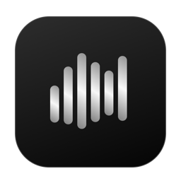
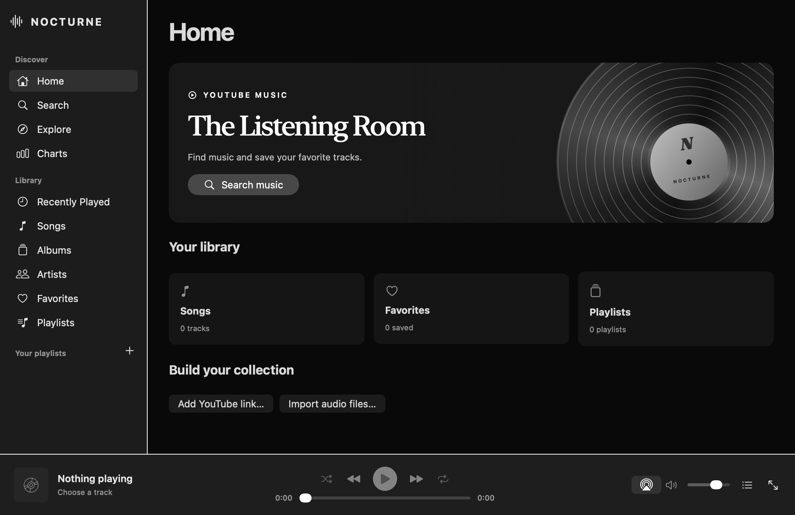
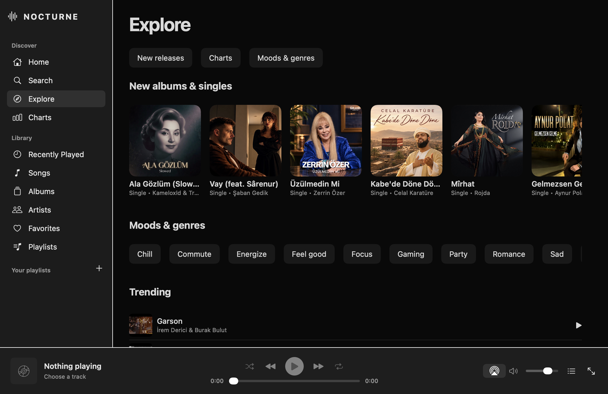
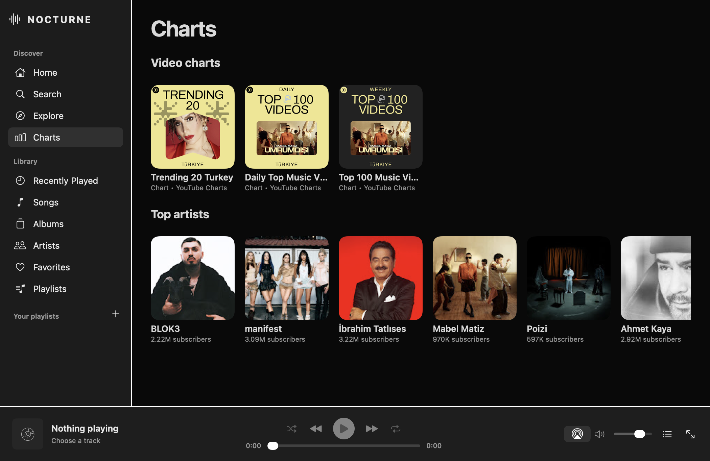

<p align="center">
  
</p>

<h1 align="center">NOCTURNE</h1>

<p align="center">
  A native macOS music player for YouTube Music and your local audio files.<br>
  Built with SwiftUI and AppKit. No API key, no Electron, no dependencies.
</p>

<p align="center">
  
  
  
  
</p>

<p align="center"><a href="README.tr.md">Türkçe</a></p>



## Features

- **Search all of YouTube** from a native search field. Results appear as native rows; nothing opens in a browser.
- **Explore and Charts** as native pages: new releases, moods and genres, trending tracks, top charts and top artists for your region.
- **Playlists from YouTube Music**
  - Sign in once inside the app and your library playlists (including Liked Music) are copied over and refreshed automatically.
  - Or paste any public playlist or album link (⌘L) to import it as a local playlist.
- **Time-synced lyrics.** Click the artwork to open Now Playing; the current line is highlighted and follows the song. Click a line to jump to it.
- **Background playback.** Music keeps playing when the app is hidden, minimized or the video is hidden.
- **Local audio files.** Import anything macOS can play (⌘O). Tags, artwork and duration are read with AVFoundation.
- **Library.** Favorites, playlists, drag and drop, albums and artists, listening history, recent searches. Stored locally in SQLite.
- **Players.** Bottom bar, expanded Now Playing, Mini Player (⇧⌘M), media keys, Now Playing in Control Center, Dock menu and Touch Bar.
- **Customization.** English and Turkish interface, light and dark appearance, your own background image.

| Explore | Charts |
| --- | --- |
|  |  |

## Requirements

- macOS 14 (Sonoma) or later, Apple Silicon or Intel
- Xcode Command Line Tools (Swift 5.9 or later) to build

## Install

1. Download `NOCTURNE.dmg` from the [latest release](https://github.com/mephistoggz/nocturne/releases/latest).
2. Open it and drag NOCTURNE into Applications.
3. The app is signed ad hoc and not notarized. On first launch, right-click the app and choose Open, or allow it in System Settings → Privacy & Security.

## Build from source

```sh
git clone https://github.com/mephistoggz/nocturne.git
cd nocturne
./Scripts/release.sh
open dist/NOCTURNE.app
```

`release.sh` builds a universal app, signs it ad hoc and writes `dist/NOCTURNE.app` and `dist/NOCTURNE.dmg`. The app is not notarized, so Gatekeeper may ask for confirmation on first launch.

For development:

```sh
swift build
swift test --no-parallel --disable-xctest -Xswiftc -gnone
```

The interface language switch only works in the packaged app, because the translations live in the app bundle.

## Keyboard shortcuts

| Shortcut | Action |
| --- | --- |
| ⌘F | Search |
| ⌘L | Add a YouTube link (song, playlist or album) |
| ⌘O | Import audio files |
| ⌘N | New playlist |
| Space | Play / pause |
| ⌘→ / ⌘← | Next / previous track |
| ⇧⌘M | Mini Player |

## How it works

| Part | Source |
| --- | --- |
| Search, Explore, Charts, playlist import | The keyless endpoints the YouTube and YouTube Music websites use themselves |
| Playback of YouTube tracks | The official YouTube embedded player, hosted inside the main window |
| Account playlists | Your own YouTube Music session, signed in inside the app; cookies stay in WebKit's store on your Mac |
| Lyrics | [LRCLIB](https://lrclib.net); only the track title and artist are sent |
| Local files | AVFoundation |

There is no bundled server and no analytics. The library lives in `~/Library/Application Support/NOCTURNE`.

## Limitations

- YouTube tracks need an internet connection; NOCTURNE does not download or store YouTube audio.
- Ads, quality, region locks and embedding permissions are decided by YouTube. Some videos cannot be played in an embedded player.
- The search and browse endpoints are not an official API and can change without notice.
- Lyrics are not available for every song, and timing can drift when the video differs from the album recording.
- Private playlists need the in-app sign-in.

## Project layout

| File | Purpose |
| --- | --- |
| `Session.swift` | Playback state, queue, library changes |
| `InlinePlayer.swift` | Embedded YouTube player |
| `RecordingSearch.swift`, `Browse.swift` | Search, Explore, Charts, playlist pages |
| `MusicAccount.swift`, `AccountSync.swift` | YouTube Music sign-in and playlist sync |
| `Lyrics.swift` | Synced lyrics |
| `Library.swift` | Models and SQLite storage |
| `MainWindow.swift`, `CatalogView.swift`, `Components.swift`, `Sheets.swift` | Interface |
| `Resources/tr.lproj` | Turkish translation |

## Contributing

Issues and pull requests are welcome. To add a language, copy `Resources/tr.lproj/Localizable.strings`, translate the right-hand side and add the language code to `CFBundleLocalizations` in `Resources/Info.plist`.

## Disclaimer

NOCTURNE is an independent project. It is not affiliated with, endorsed by or sponsored by Google, YouTube or Apple. YouTube and YouTube Music are trademarks of Google LLC. Use it in line with the terms of the services you connect to.

## License

[MIT](LICENSE) © 2026 Burak Sarıkaya

---

<sub>Keywords: macOS YouTube Music client, native YouTube Music player for Mac, SwiftUI music player, YouTube Music desktop app, synced lyrics, mini player, Touch Bar, open source.</sub>
